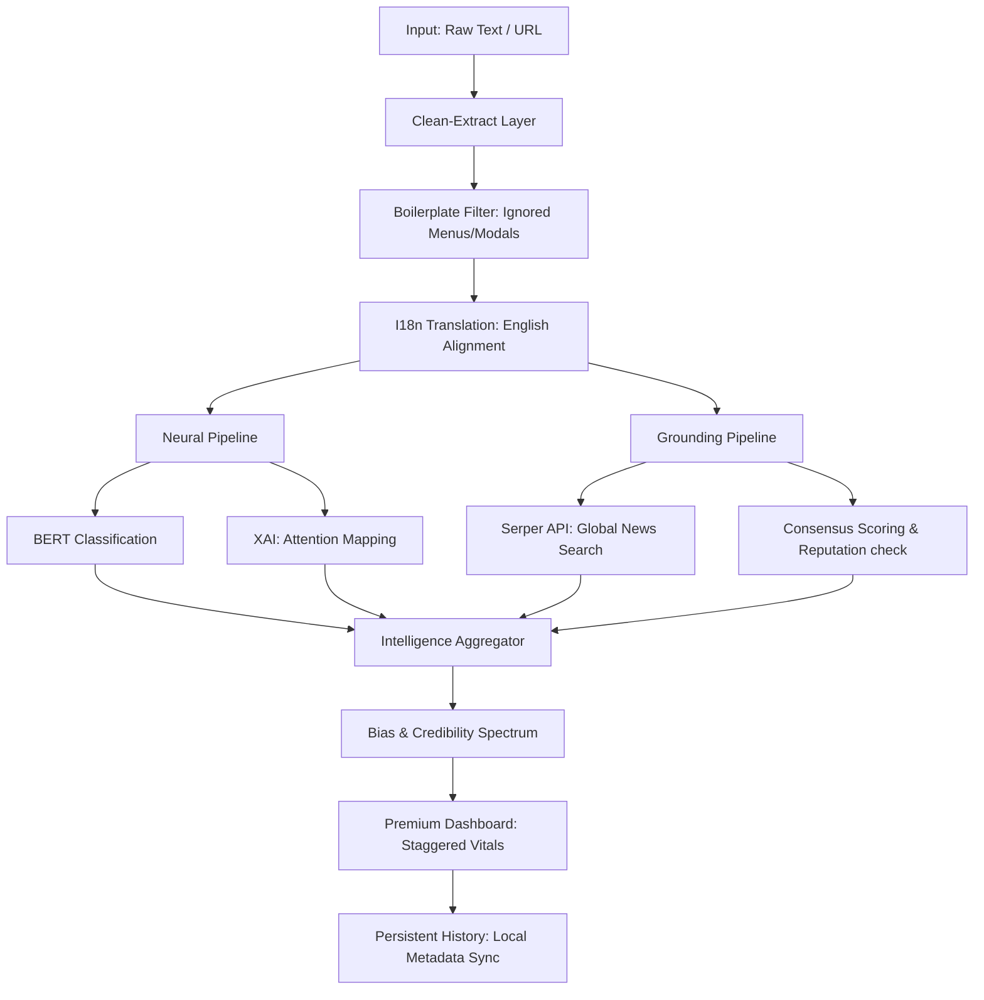

# Factra V2.0: Intelligence Suite Architecture
> **Technical Reference Guide for Project Demo & Viva**

## 1. Project Objective & Vision
Factra is an **Intelligence-First** misinformation detection suite. Unlike basic classifiers, Factra V2.0 aims for **"Grounding"**—it doesn't just guess if a text is fake based on style; it verifies the claim against the global news landscape in real-time.

---

## 2. The Core Intelligence Pillars
Factra processes every claim through four robust analysis layers to arrive at a "Intelligence-Backed" credibility score.

### Pillar 1: Neural Engine (BERT v2)
*   **Architecture:** Fine-tuned `bert-base-uncased` transformer.
*   **Contextual Depth:** Uses self-attention to understand linguistic nuances, identifying sarcasm, bias, and semantic patterns that simple keyword filters miss.

### Pillar 2: Web Consensus Engine (The Grounding Layer) [NEW in V2.0]
*   **Mechanism:** Queries the **Serper.dev API** (Google News index) in real-time.
*   **Consensus Scoring:** It performs semantic cross-verification. If a story is "Breaking" on Factra but absent from global news repos, it triggers a **"Low Consensus"** warning.
*   **Reputation Awareness:** Automatically identifies and tags reporting from global trusted outlets (BBC, Reuters, AP, etc.), giving them higher weight in the final score.

### Pillar 3: XAI (Explainable AI)
*   **Attention Weights:** Extracts importance mappings from the BERT model to highlight "Suspicious Cues" directly in the article.
*   **Transparency:** Ensures the user isn't just seeing a number, but understanding the **decision logic** of the neural network.

### Pillar 4: Linguistic Fingerprinting
*   **Tone & Objectivity:** Classifies content as *Alarmist*, *Subjective*, or *Fact-Focused*.
*   **Complexity Index:** Measures "Syntactic Complexity"—Fake news often uses simpler, more emotional language compared to academic or formal reporting.

---

## 3. Advanced V2.0 System Architecture

---

## 4. Technical Stack (The Factra Ledger)
*   **Backend:** Python 3.x, Flask (Distributed REST Architecture).
*   **Intelligence:** PyTorch, Transformers, Serper.dev API.
*   **Frontend:** Vanilla ES6+ JS, CSS3 Modern (Glassmorphism), Google Fonts (Poppins & Lora).
*   **Verification:** Google Fact Check Tools API.
*   **Extraction:** BeautifulSoup4 with custom "Smart Boilerplate" heuristics.

---

## 5. Viva Preparation: Key Questions

**Q: What is "Web Consensus" and why is it superior to just AI prediction?**
*   *Answer:* AI models can be fooled by professional-looking fake news. **Web Consensus** provides a "sanity check." It asks: *"Is anyone else in the world reporting this?"* If a massive claim has zero coverage on reputable news wires (Reuters, AP), the consensus score drops, alerting the user to a potential "Isolated Fabricated Event."

**Q: How do you handle "Boilerplate" during web scraping?**
*   *Answer:* We implemented a **"Selective Scraper."** It specifically searches for `
` tags but filters out anything inside `nav`, `header`, `footer`, or `modal` containers. This prevents common errors where the AI mistakenly analyzes the website's cookie policy instead of the news story.

**Q: How is the Credibility Score calculated in V2.0?**
*   *Answer:* It's a weighted average: `(BERT Confidence * 0.4) + (Consensus Score * 0.4) + (Source Reputation * 0.2)`. Penalties are then applied for linguistic patterns like "All-Caps" or "Alarmist Tone."

**Q: Why use a Chrome Extension for a Project like this?**
*   *Answer:* It places the tool where the misinformation happens: **In the browser.** It uses the Chrome Scripting API to inject highlights directly into the live DOM, providing a "Cybersecurity" feel to news browsing.

---

## 6. How to Demo (The "Wow" Factor)
1.  **The Extension Handoff:** Analyze a text and click "Open Dashboard" to show the smooth data transfer.
2.  **Consensus Check:** Find a real breaking news item. Show the **"Widespread Reporting"** tags in the Consensus Card.
3.  **Linguistic Profile:** Show how the "Tone" changes from a scientific article (Neutral) to a clickbait headline (Alarmist).
4.  **History Persistence:** Click an old scan to show how the Dashboard instantly restores the full report without re-loading.
